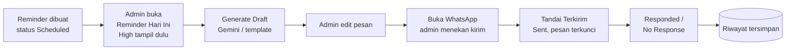
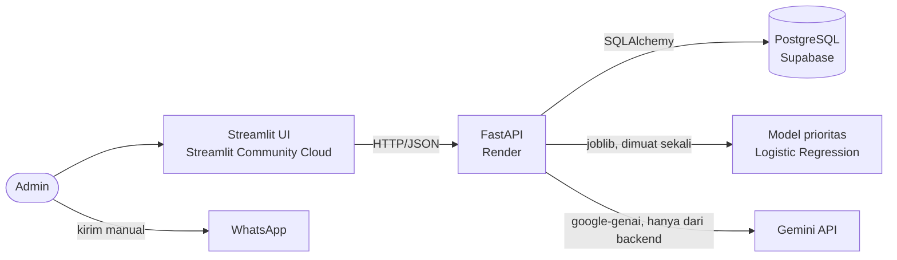

# Gymnasium Smart Reminder & Follow-up

> ⚠️ **PROTOTYPE — seluruh data adalah data synthetic.** Model ML dan draft pesan AI di proyek ini dilatih dan
> dievaluasi pada data buatan, sehingga angka-angka di bawah **bukan klaim akurasi di kondisi nyata**. Pesan
> **tidak pernah dikirim otomatis**: admin yang mengirim lewat WhatsApp dan memperbarui statusnya.

Capstone Project Dicoding Bootcamp · ID tim **DB15-I038** · dikerjakan individu oleh **Eugenia Huwaida Imtinan**
(jalur Gen AI) · Oktober–November 2026 · Lisensi MIT.

| | URL |
|---|---|
| UI admin (Streamlit Community Cloud) | _diisi setelah deploy_ |
| API + dokumentasi Swagger (Render) | _diisi setelah deploy_ (`/docs`) |

> Catatan akses: Render free tier "tidur" setelah 15 menit tanpa trafik; pembukaan pertama bisa memakan sekitar
> 1 menit.

## Masalah dan solusi

**Gymnasium** adalah gym dan private coaching dengan pelanggan utama ibu-ibu, lansia, dan segmen menengah ke atas.
Reminder kelas dan follow-up customer selama ini dilakukan manual lewat WhatsApp tanpa panduan siapa yang perlu
diprioritaskan, dan admin menulis setiap pesan dari nol.

Aplikasi web khusus **admin** ini membantu tiga hal:

1. **Prioritas follow-up** — model machine learning yang dilatih sendiri mengklasifikasikan setiap customer menjadi
   **Low / Medium / High** dari riwayat kehadiran dan respons, beserta alasan singkat untuk admin.
2. **Draft pesan** — Generative AI (**Gemini**) menyusun draft WhatsApp sesuai **persona** customer dan
   **prioritas**, dengan pemeriksaan otomatis dan template cadangan bila AI gagal.
3. **Pencatatan status** — admin mengedit draft, mengirim **sendiri** lewat WhatsApp (link `wa.me` dengan teks
   terisi), lalu mencatat status `Sent` → `Responded` / `No Response`; riwayat tersimpan.

**Research question:** apakah model ML lebih baik dari baseline sederhana, dan bagaimana GenAI mengubah hasil
klasifikasi menjadi draft yang siap pakai admin?

## Alur end-to-end



## Tangkapan layar

<!-- Tambahkan file ke docs/screenshots/ lalu hapus tanda komentar di bawah ini.


-->
_Tangkapan layar ditambahkan pemilik setelah deploy._

## Hasil

### Model prioritas (data synthetic, test set 263 baris, customer tidak beririsan dengan train)

| Model | Macro-F1 test | Macro-F1 CV 5-fold (rata-rata ± std) | Recall High test |
|---|---|---|---|
| Dummy (kelas terbanyak) | 0,217 | 0,217 ± 0,001 | 0,000 |
| Baseline rule-based (kehadiran 30 hari + absen berturut) | 0,610 | 0,565 ± 0,050 | 0,673 |
| **Logistic Regression (dipakai)** | **0,670** | **0,666 ± 0,019** | **0,691** |
| Random Forest | 0,708 | 0,661 ± 0,035 | 0,673 |

- **Lebih baik dari baseline, tetapi moderat**: +0,06 macro-F1 di test, +0,10 di CV; recall High sedikit lebih
  tinggi.
- Logistic Regression dipilih dari **macro-F1 cross-validation pada data train** (bukan dari test set) dan karena
  recall High-nya tidak di bawah baseline. Random Forest unggul di satu split test, tetapi tidak di CV dan recall
  High-nya sama dengan baseline.
- Kelas **Medium paling lemah** (F1 0,530); kelas Low paling mudah (F1 0,829).
- Detail, confusion matrix, dan fitur berpengaruh: [`docs/MODEL_EVALUATION.md`](docs/MODEL_EVALUATION.md).

### Draft pesan Gemini (9 skenario = 3 persona × 3 prioritas, `gemini-3.5-flash-lite`)

| Versi prompt | Draft dari Gemini | Nada | Info kelas | Tanpa kebocoran label | Tanpa fakta karangan | Siap kirim | Rata-rata |
|---|---|---|---|---|---|---|---|
| v1 | 9/9 | 3,67 | 4,89 | 5,00 | 4,89 | 3,56 | 4,40 |
| v2 | 9/9 | 4,56 | 4,78 | 5,00 | 4,89 | 4,44 | 4,73 |

Skala 1–5. **Rubrik dinilai dengan bantuan model AI (LLM-as-judge), belum ditinjau evaluator manusia**, dengan
9 skenario dan satu kali jalan per versi — kenaikan v1 → v2 bersifat **indikatif**. Masalah v1 (mengungkit pesan
lama beserta tanggalnya, asumsi "kendala serius", partikel santai untuk segmen profesional, doa berulang) tidak
muncul lagi di v2. Detail: [`docs/PROMPT_ENGINEERING.md`](docs/PROMPT_ENGINEERING.md).

## Fitur

- **Reminder Hari Ini** — pilih tanggal kelas; daftar diurutkan High → Medium → Low lalu kelas terdekat; badge
  prioritas dan peluang; tombol *Lihat alasan prioritas* (hanya untuk admin); *Generate Draft* / *Generate ulang*;
  kotak edit; *Simpan pesan*; *Buka WhatsApp* (teks terisi); konfirmasi + *Tandai Terkirim*; *Responded* /
  *No Response*; riwayat status; form buat reminder baru.
- **Customer** dan **Jadwal** — tambah, ubah, hapus (validasi nomor WhatsApp di backend).
- **Riwayat Reminder** — semua reminder satu customer beserta riwayat perubahan statusnya.
- **Draft selalu tersedia** — jika Gemini kena kuota (429), timeout, API key kosong, atau draft melanggar aturan
  setelah 1 kali regenerasi, sistem memakai template cadangan per persona × jenis pesan dan memberi peringatan.
- **Aturan keamanan pesan** — draft dilarang menyebut prioritas/risiko/AI/skor, mengarang jadwal/harga/promo,
  memberi klaim kesehatan, atau bernada menyalahkan; post-check menolak pelanggaran secara otomatis.

## Arsitektur



UI tidak pernah mengakses database atau Gemini langsung. Fitur dihitung dengan modul yang sama saat training dan
inference (`src/ml/feature_engineering.py`). Detail: [`docs/ARCHITECTURE.md`](docs/ARCHITECTURE.md).

| Layer | Teknologi |
|---|---|
| Data & ML | Python 3.12, pandas, NumPy, scikit-learn, Matplotlib/Seaborn, Jupyter, joblib |
| Backend | FastAPI (REST + Swagger/OpenAPI), SQLAlchemy, Pydantic |
| UI | Streamlit |
| Database | PostgreSQL (Supabase) |
| Generative AI | Gemini API (`google-genai`), dipanggil hanya dari backend |
| Deployment | Render (API) + Streamlit Community Cloud (UI) |

## Struktur repo

```
├── src/
│   ├── data_generation/   # generator data synthetic (seed 42), seed ke DB, data demo "hari ini"
│   ├── ml/                # feature engineering, training, evaluasi, inference, artefak model
│   ├── api/               # FastAPI: routers, schemas, services (prediksi, Gemini, post-check, template), db
│   └── ui/                # Streamlit: app.py, pages/, api_client.py, requirements.txt (khusus UI)
├── notebooks/             # 01_eda.ipynb, 02_modeling.ipynb
├── data/                  # raw/ dan processed/ (synthetic)
├── sql/migrations/        # 001_init.sql (7 tabel)
├── docs/                  # dokumentasi (lihat daftar di bawah) + draft_eval/ (hasil evaluasi prompt)
├── tests/                 # 215 tes (SQLite in-memory, klien Gemini palsu, tanpa jaringan)
├── requirements.txt       # dependensi API (Render)
├── requirements-dev.txt   # pengembangan: API + UI + notebook + tes
└── render.yaml            # Blueprint Render
```

## Menjalankan secara lokal (Windows PowerShell)

Prasyarat: Python 3.12, project Supabase (gratis), API key Gemini dari [Google AI Studio](https://aistudio.google.com)
(opsional — tanpa key, draft memakai template cadangan).

```powershell
# 1. Lingkungan
python -m venv .venv
.\.venv\Scripts\Activate.ps1
pip install -r requirements-dev.txt

# 2. Konfigurasi: salin lalu isi DATABASE_URL (Supabase Session pooler), GEMINI_API_KEY, GEMINI_MODEL
Copy-Item .env.example .env
```

3. Buat tabel: jalankan isi `sql/migrations/001_init.sql` di **Supabase → SQL Editor**.

```powershell
# 4. Data synthetic -> database, lalu perpanjang timeline sampai hari ini (jalankan ulang sebelum setiap demo)
python -m src.data_generation.generate
python -m src.data_generation.seed_db
python -m src.data_generation.seed_demo

# 5. Terminal 1 - API (http://localhost:8000/docs)
uvicorn src.api.main:app --reload

# 6. Terminal 2 - UI (http://localhost:8501)
streamlit run src/ui/app.py

# Tes (tidak memakai jaringan, Supabase, maupun Gemini)
python -m pytest tests -q
```

Melatih ulang model (opsional): `python -m src.ml.train`. Evaluasi draft dengan Gemini sungguhan:
`python -m src.api.services.draft_eval`.

## Deploy

Ringkasnya: API ke **Render** memakai `render.yaml` (Python 3.12.10, start `uvicorn src.api.main:app --host
0.0.0.0 --port $PORT`, health check `/health`), UI ke **Streamlit Community Cloud** dengan file utama
`src/ui/app.py` dan secret `API_BASE_URL`. Langkah lengkap: [`docs/DEPLOYMENT.md`](docs/DEPLOYMENT.md).

## Dokumentasi

| Dokumen | Isi |
|---|---|
| [ADMIN_GUIDE.md](docs/ADMIN_GUIDE.md) | Panduan pemakaian untuk admin, langkah demi langkah |
| [ARCHITECTURE.md](docs/ARCHITECTURE.md) | Arsitektur, struktur kode backend dan UI |
| [API_DOCS.md](docs/API_DOCS.md) | Endpoint, alur status, kode error |
| [DATABASE_SCHEMA.md](docs/DATABASE_SCHEMA.md) | Skema 7 tabel |
| [SYNTHETIC_DATA.md](docs/SYNTHETIC_DATA.md) | Cara data synthetic dan label dibuat (tanpa leakage) |
| [MODEL_EVALUATION.md](docs/MODEL_EVALUATION.md) | Protokol dan hasil evaluasi model |
| [PROMPT_ENGINEERING.md](docs/PROMPT_ENGINEERING.md) | Prompt, persona, post-check, fallback, evaluasi v1 → v2 |
| [AI_SPEC.md](docs/AI_SPEC.md) | Spesifikasi ML dan GenAI yang mengikat |
| [DEPLOYMENT.md](docs/DEPLOYMENT.md) | Deploy Render + Streamlit Community Cloud |
| [ASSUMPTIONS.md](docs/ASSUMPTIONS.md) | Semua asumsi dan keputusan desain |
| [CREDITS_AND_LICENSES.md](docs/CREDITS_AND_LICENSES.md) | Library, layanan, dan lisensinya |
| [PRESENTATION_OUTLINE.md](docs/PRESENTATION_OUTLINE.md) | Kerangka Project Brief, slide, dan naskah video |

## Keterbatasan dan risiko yang diketahui

- **Data synthetic.** Pola perilaku member sungguhan bisa berbeda; performa nyata tidak dapat disimpulkan.
- **Keunggulan model moderat** dan kelas **Medium lemah**; prioritas adalah bantuan, keputusan tetap di admin.
- **API publik tanpa autentikasi** (spesifikasi: admin-only tanpa login). Siapa pun yang tahu URL API bisa
  memanggilnya; jangan memasukkan data customer sungguhan ke deployment ini.
- **Free tier**: Render tidur setelah 15 menit (bangun ±1 menit), Supabase ter-pause setelah 1 minggu tidak aktif,
  kuota harian Gemini kecil (429 → template cadangan). Free tier Gemini boleh memakai input untuk perbaikan produk
  Google, sehingga hanya data synthetic yang dikirim.
- **Post-check berbasis pola kata**: bisa meloloskan pelanggaran halus atau menolak kalimat wajar; admin tetap
  wajib membaca draft.
- **Evaluasi draft** hanya 9 skenario dan dinilai dengan bantuan model AI.

## Lisensi dan kredit

Kode dibuat dari nol untuk proyek ini dan dirilis dengan lisensi [MIT](LICENSE). Daftar library, layanan, dan
lisensinya ada di [`docs/CREDITS_AND_LICENSES.md`](docs/CREDITS_AND_LICENSES.md).
