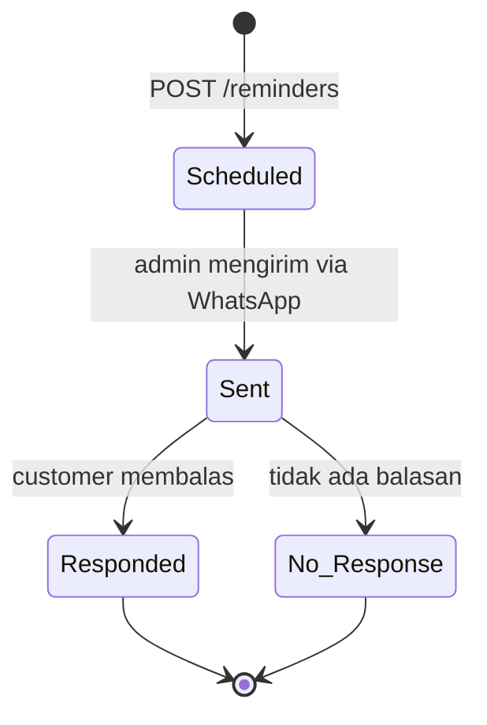

# Dokumentasi API

Backend: FastAPI. Dokumentasi interaktif otomatis (Swagger/OpenAPI): **`/docs`** (ReDoc: `/redoc`, skema: `/openapi.json`).

> **PROTOTYPE.** Model prioritas dilatih pada data synthetic. Pesan **tidak dikirim otomatis**: admin mengirim
> lewat WhatsApp lalu memperbarui status secara manual.

## Menjalankan lokal

```bash
# .env berisi DATABASE_URL (Supabase, Session pooler). Model dimuat dari src/ml/artifacts/.
uvicorn src.api.main:app --reload          # http://localhost:8000/docs
python -m src.data_generation.seed_demo    # opsional: lanjutkan data synthetic sampai hari ini (untuk demo)
python -m pytest tests -q
```

Konfigurasi lewat environment variable: `DATABASE_URL`, `CORS_ORIGINS` (pisahkan koma), `LOG_LEVEL`,
`APP_TIMEZONE`, `GEMINI_API_KEY`/`GEMINI_MODEL` (Fase 4).

## Konvensi

- Waktu = waktu lokal **WIB** tanpa zona (ISO 8601, mis. `2026-11-02T09:00:00`). Waktu ber-zona dikonversi ke WIB.
- Daftar memakai pagination: `?limit=` (1-200, default 50) dan `?offset=`; respons `{items, total, limit, offset}`.
- Semua error berformat `{"detail": "<pesan Indonesia>", "code": "<kode_mesin>"}`.
- Nomor WhatsApp diterima sebagai `08...`, `+628...`, atau `628...` dan disimpan sebagai `628...`.

## Endpoint

| Method | Path | Fungsi |
|---|---|---|
| GET | `/health` | Status layanan: `status`, `db_connected`, `model_loaded`, `model_version` |
| GET / POST | `/customers` | Daftar (`q`, `persona`) / tambah customer |
| GET / PATCH / DELETE | `/customers/{id}` | Detail / ubah / hapus (beserta riwayatnya) |
| GET | `/customers/{id}/reminders` | Riwayat reminder customer (terbaru dulu) |
| GET / POST | `/schedules` | Daftar (`date_from`, `date_to`, `tipe`) / tambah jadwal |
| GET / PATCH / DELETE | `/schedules/{id}` | Detail / ubah / hapus jadwal |
| GET | `/reminders` | Daftar: `date` (`today` atau `YYYY-MM-DD`, **tanggal kelas**), `status`, `priority`, `customer_id` |
| POST | `/reminders` | Buat reminder (status `Scheduled`; prioritas terisi otomatis bila model tersedia) |
| GET | `/reminders/{id}` | Detail reminder (termasuk ringkasan customer dan jadwal) |
| GET | `/reminders/{id}/history` | Riwayat perubahan status |
| PATCH | `/reminders/{id}/status` | Ubah status (divalidasi, lihat alur di bawah) |
| PATCH | `/reminders/{id}/message` | Simpan `final_message` (hanya saat `Scheduled`) |
| POST | `/reminders/{id}/refresh-priority` | Hitung ulang prioritas dengan model ML |
| POST | `/predict` | Prediksi prioritas satu customer, hasil disimpan di tabel `predictions` |
| POST | `/generate-draft` | **Placeholder** (501) sampai Fase 4 |

Urutan `GET /reminders`: prioritas **High, Medium, Low, lalu tanpa prioritas**; pada prioritas sama, kelas yang
paling dekat waktunya lebih dulu.

## Alur status reminder



Aturan: hanya `Scheduled → Sent` dan `Sent → Responded | No Response`. Transisi lain (termasuk ke status yang
sama atau keluar dari status final) ditolak dengan **409** `invalid_status_transition`. `sent_at` dan
`responded_at` terisi otomatis, setiap perubahan dicatat di `reminder_status_history`. Saat menjadi `Sent`,
jika `final_message` kosong dan ada `draft_message`, draft disalin menjadi `final_message` (dikirim apa adanya).

## Contoh (respons nyata dari server lokal)

`GET /health`
```json
{"status": "ok", "db_connected": true, "model_loaded": true, "model_version": "lr-20261031-v1"}
```

`POST /predict` dengan `{"customer_id": 1, "reference_date": "2026-11-02"}`
```json
{
  "customer_id": 1, "reference_date": "2026-11-02", "priority": "Low",
  "probabilities": {"Low": 0.6079, "Medium": 0.3001, "High": 0.092},
  "top_factors": ["5 reminder terakhir tidak direspons", "jarang merespons reminder (30% direspons)"],
  "model_version": "lr-20261031-v1", "cold_start": false, "note": null, "prediction_id": 263
}
```
`top_factors` untuk **admin** (alasan prioritas), jangan diteruskan ke customer. Customer dengan riwayat < 3
kejadian: `cold_start: true`, `note: "riwayat belum cukup"`, prioritas dibatasi Low/Medium.

`PATCH /reminders/{id}/status` dengan `{"status": "Responded"}` saat masih `Scheduled` → **409**
```json
{"detail": "Transisi 'Scheduled' → 'Responded' tidak diizinkan. Dari 'Scheduled' hanya boleh ke 'Sent'. Alur yang valid: Scheduled → Sent → Responded / No Response.",
 "code": "invalid_status_transition"}
```

## Kode error

| HTTP | `code` | Arti |
|---|---|---|
| 404 | `not_found` | Data atau endpoint tidak ada |
| 409 | `invalid_status_transition` | Transisi status tidak valid |
| 409 | `message_locked` | Pesan tidak bisa diubah setelah `Sent` |
| 409 | `duplicate_whatsapp` | Nomor WhatsApp sudah terdaftar |
| 409 | `duplicate_reminder` | Reminder aktif yang sama (customer + kelas + jenis pesan) sudah ada |
| 422 | `validation_error` | Input tidak valid (pesan merinci field) |
| 422 | `invalid_date` | Parameter `date` bukan `today` / `YYYY-MM-DD` |
| 501 | `not_implemented` | `/generate-draft` (sampai Fase 4) |
| 503 | `model_unavailable` | Artefak model tidak termuat; API tetap hidup |
| 503 | `database_unavailable` | `DATABASE_URL` kosong / database tidak terjangkau |
| 500 | `internal_error` | Kesalahan tak terduga (detail hanya di log server) |
