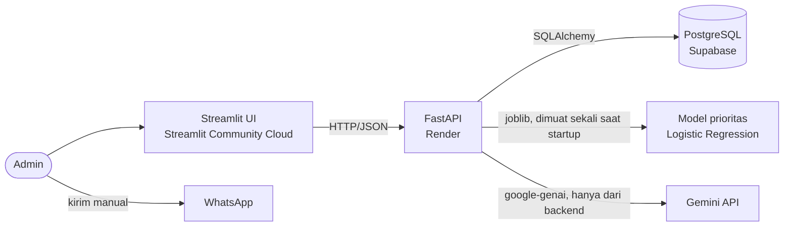

# Arsitektur Sistem



## Prinsip desain

- **UI tidak pernah mengakses database atau Gemini langsung**; semuanya lewat FastAPI.
- **Satu modul fitur** (`src/ml/feature_engineering.py`) dipakai untuk training dan inference, sehingga tidak ada
  train-serve skew. `/predict` menghitung fitur dari database dengan fungsi yang sama.
- **Model dimuat sekali** saat startup. Jika artefak hilang atau tidak cocok, API tetap hidup: `/health` melaporkan
  `model_loaded=false` dan `/predict` membalas 503.
- **Admin tetap mengendalikan**: pesan tidak dikirim otomatis, tidak ada integrasi API WhatsApp/Rezerv.
- **Validasi alur status di backend**, bukan hanya di UI (`src/api/services/status_flow.py`).
- **Rahasia lewat environment variable** (`.env` tidak di-commit).
- **Draft selalu tersedia**: Gemini → post-check (1x regenerasi) → template cadangan per persona × jenis pesan.
  Klien Gemini disuntik (`create_app(draft_generator=...)`), sehingga tes tidak pernah memanggil jaringan.
  Detail: `docs/PROMPT_ENGINEERING.md`.

## Struktur kode backend

```
src/api/
├── main.py            # create_app(), CORS, lifespan (muat model), middleware log
├── config.py          # Settings dari env
├── errors.py          # APIError + handler ({"detail","code"})
├── deps.py            # get_db, get_model, get_draft_generator
├── timeutil.py        # waktu WIB, masking nomor di log
├── db/                # engine & session (driver psycopg2), model ORM
├── schemas/           # skema Pydantic (request/response)
├── routers/           # health, customers, schedules, reminders, predict, drafts
└── services/
    ├── status_flow.py         # transisi status
    ├── prediction_service.py  # fitur + prediksi
    ├── prompt_builder.py      # konteks draft, sapaan, system instruction + few-shot
    ├── gemini_client.py       # klien google-genai: timeout, retry terbatas, klasifikasi error
    ├── post_check.py          # validasi draft (kata terlarang, panjang, jadwal karangan, ...)
    ├── templates.py           # template cadangan 3 persona x 3 jenis pesan
    ├── draft_service.py       # alur /generate-draft (cache, 404/409, fallback)
    └── draft_eval.py          # skrip evaluasi 9 skenario (dijalankan pemilik)
```

## Data demo

Data synthetic berakhir 30 Sep 2026. `python -m src.data_generation.seed_demo` melanjutkan timeline sampai hari
ini (jadwal, kehadiran, reminder, dan reminder `Scheduled` berprioritas) sehingga fitur dan halaman "Reminder
Hari Ini" bermakna. Skrip ini idempotent: menghapus data setelah 30 Sep lalu membuatnya ulang.
