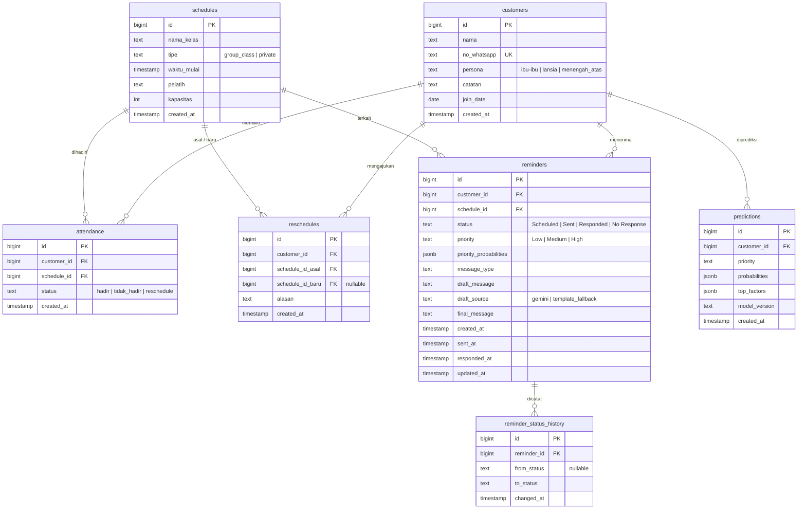
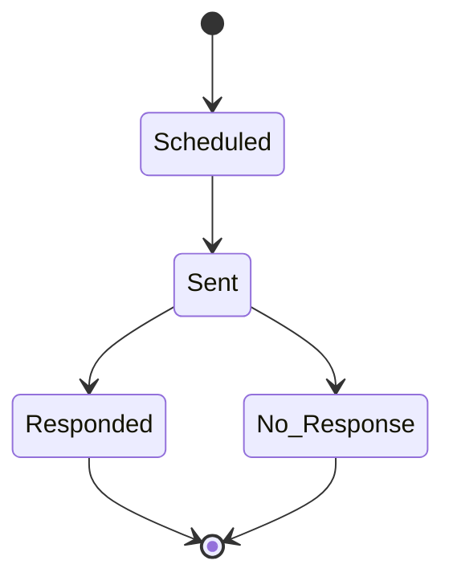

# Skema Database

Database: PostgreSQL (Supabase). Migrasi: `sql/migrations/001_init.sql`.
Semua waktu bertipe `TIMESTAMP` tanpa zona dan dianggap waktu lokal **WIB**, konsisten dengan data synthetic.

## Diagram ER

## Catatan desain

- **Enum** dijaga lewat `CHECK` constraint (bukan tipe ENUM) agar mudah diubah lewat migrasi.
- **ID** memakai `GENERATED BY DEFAULT AS IDENTITY`: boleh diisi eksplisit saat seed, lalu sequence disinkronkan oleh `seed_db.py`.
- `attendance` punya `UNIQUE (customer_id, schedule_id)`: satu customer hanya punya satu catatan per jadwal.
- `reminders.priority` boleh `NULL`: reminder historis synthetic tidak punya prioritas; terisi saat `/predict` atau `/refresh-priority`.
- `reminders.draft_message` (keluaran Gemini/template) dipisah dari `final_message` (teks yang benar-benar dikirim admin).
- `reminder_status_history.from_status` bernilai `NULL` untuk entri pertama (pembuatan reminder, status `Scheduled`).
- `reschedules.schedule_id_baru` boleh `NULL` bila belum ada jadwal pengganti.
- Hapus customer akan ikut menghapus data terkait (`ON DELETE CASCADE`); hapus jadwal pada `reminders` hanya mengosongkan `schedule_id`.

## Alur status reminder

Validasi transisi dilakukan di backend (Fase 3), bukan hanya di database.
