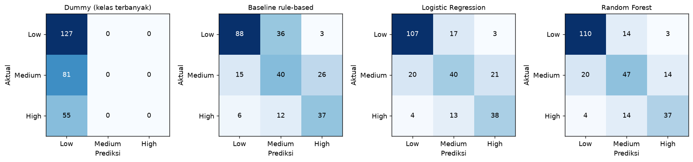
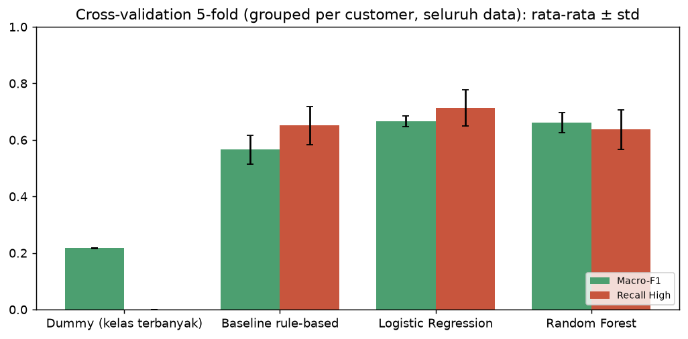
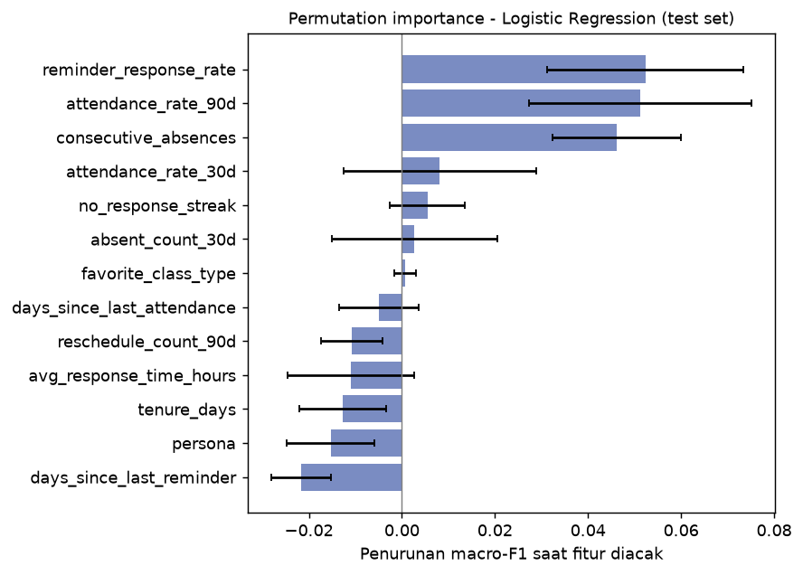
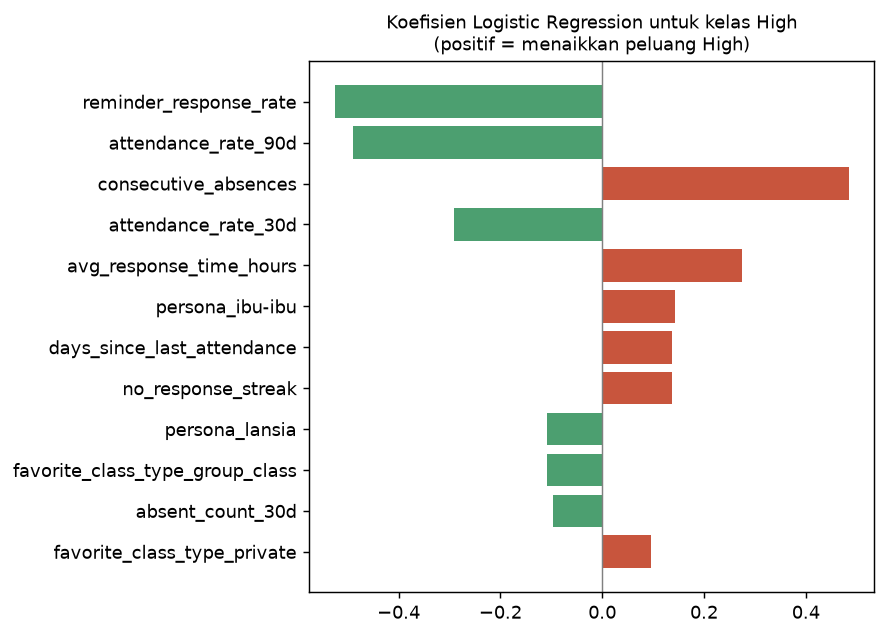

# Evaluasi Model Prioritas Follow-up

> **DISCLAIMER:** Model dilatih dan dievaluasi pada **data synthetic** (lihat `docs/SYNTHETIC_DATA.md`).
> Label berasal dari simulasi, bukan keputusan admin Gymnasium yang sebenarnya. Angka di dokumen ini
> menunjukkan bahwa **pipeline bekerja dan lebih baik dari baseline pada data simulasi**, dan **bukan klaim
> akurasi di kondisi nyata**. Statusnya: **prototype**.

## 1. Tujuan dan research question

> Bagaimana model klasifikasi machine learning berbasis riwayat aktivitas customer dapat menentukan prioritas
> follow-up (Low, Medium, High) dengan performa lebih baik daripada baseline sederhana?

Tugas: klasifikasi 3 kelas per customer pada suatu `reference_date`, dengan fitur dari riwayat kehadiran,
reschedule, dan respons reminder **sebelum** tanggal itu (`src/ml/feature_engineering.py`).

## 2. Data dan protokol evaluasi

- Dataset: `data/processed/training_dataset.csv`, 1.304 baris (3-4 snapshot per customer dari 400 customer).
- **Split 80/20 stratified dan grouped per `customer_id`**: satu customer tidak pernah ada di train dan test
  sekaligus (dijaga dengan `assert` di kode dan test otomatis). Tanpa pengelompokan, snapshot customer yang
  sama akan muncul di kedua sisi dan skor test menjadi terlalu optimis.
- `customer_id` dan `reference_date` **bukan** fitur. Kolom `n_history_events` hanya untuk deteksi cold start.
- Tuning hyperparameter memakai `StratifiedGroupKFold` 5-fold **hanya pada data train**, dengan scoring macro-F1.
- Karena test set kecil (sekitar 260 baris), ditambahkan cross-validation 5-fold grouped pada seluruh data
  untuk melihat variansi antar fold.

## 3. Model yang dibandingkan

| Model | Keterangan |
|---|---|
| Dummy | Selalu menebak kelas terbanyak (batas bawah) |
| Baseline rule-based | Hanya memakai `attendance_rate_30d` dan `consecutive_absences` dengan ambang tetap. Aturan: High jika kehadiran 30 hari < 0,40 atau absen berturut-turut >= 3; Medium jika kehadiran < 0,65 atau absen >= 1; selain itu Low. Aturan ini **berbeda** dari rumus pembuat label |
| Logistic Regression | `class_weight='balanced'`, tuning `C` |
| Random Forest | `class_weight='balanced'`, tuning `n_estimators`, `max_depth`, `min_samples_leaf` |

Preprocessing (satu pipeline bersama model, disimpan sebagai satu artefak): fitur numerik diimputasi median
lalu di-standarisasi; fitur kategorikal diimputasi modus lalu di-one-hot.

## 4. Metrik yang dipakai dan alasannya

- **Recall kelas High** adalah metrik prioritas: kesalahan paling mahal adalah customer yang benar-benar perlu
  perhatian tetapi tidak muncul sebagai prioritas tinggi (*false negative* High).
- **Macro-F1** memperlakukan ketiga kelas sama penting, sehingga tidak tertipu oleh kelas Low yang dominan.
- Akurasi dilaporkan sebagai pelengkap saja. Precision, recall, dan F1 dilaporkan per kelas.

## 5. Hasil

<!-- RESULTS_START -->
_Bagian ini dibuat otomatis oleh `python -m src.ml.train` (versi model `lr-20261031-v1`, seed 42, scikit-learn 1.9.1). Jangan diedit manual._

Data: 1304 baris; train 1041, test 263; customer di train dan test tidak beririsan. Distribusi kelas: Low 48.3%, Medium 30.6%, High 21.1%.

### Hasil pada test set

| Model | Accuracy | Macro-F1 | Recall High | Precision High | F1 High |
|---|---|---|---|---|---|
| Dummy (kelas terbanyak) | 0.483 | 0.217 | 0.000 | 0.000 | 0.000 |
| Baseline rule-based | 0.627 | 0.610 | 0.673 | 0.561 | 0.612 |
| Logistic Regression | 0.703 | 0.670 | 0.691 | 0.613 | 0.650 |
| Random Forest | 0.738 | 0.708 | 0.673 | 0.685 | 0.679 |

**Model terpilih: Logistic Regression** (dipilih dari macro-F1 cross-validation pada data train, bukan dari test set). Syarat recall High >= baseline: terpenuhi. Akurasi test di bawah 97%: tidak ada tanda leakage dari uji kewajaran ini.

Hyperparameter terpilih: `{"Logistic Regression": {"C": 0.1}, "Random Forest": {"max_depth": 6, "min_samples_leaf": 1, "n_estimators": 200}}`

### Metrik per kelas (model terpilih, test set)

| Kelas | Precision | Recall | F1 | Support |
|---|---|---|---|---|
| Low | 0.817 | 0.843 | 0.829 | 127.000 |
| Medium | 0.571 | 0.494 | 0.530 | 81.000 |
| High | 0.613 | 0.691 | 0.650 | 55.000 |

### Confusion matrix (model terpilih, test set)

|  | Prediksi Low | Prediksi Medium | Prediksi High |
|---|---|---|---|
| Aktual Low | 107 | 17 | 3 |
| Aktual Medium | 20 | 40 | 21 |
| Aktual High | 4 | 13 | 38 |



### Gap train vs CV vs test (macro-F1)

| Model | Train macro-F1 | CV macro-F1 (train) | Test macro-F1 |
|---|---|---|---|
| Logistic Regression | 0.688 | 0.655 | 0.670 |
| Random Forest | 0.823 | 0.644 | 0.708 |

### Cross-validation 5-fold pada seluruh data (grouped per customer)

Test set hanya berisi sekitar 260 baris, sehingga satu split memiliki variansi cukup besar. Tabel ini merata-ratakan lima fold (hyperparameter tetap):

| Model | Macro-F1 (rata-rata) | Macro-F1 (std) | Recall High (rata-rata) | Recall High (std) |
|---|---|---|---|---|
| Dummy (kelas terbanyak) | 0.217 | 0.001 | 0.000 | 0.000 |
| Baseline rule-based | 0.565 | 0.050 | 0.651 | 0.067 |
| Logistic Regression | 0.666 | 0.019 | 0.713 | 0.064 |
| Random Forest | 0.661 | 0.035 | 0.636 | 0.069 |



### Fitur paling berpengaruh (permutation importance, test set)

| Fitur | importance | std |
|---|---|---|
| reminder_response_rate | 0.0523 | 0.0211 |
| attendance_rate_90d | 0.0512 | 0.0239 |
| consecutive_absences | 0.0461 | 0.0139 |
| attendance_rate_30d | 0.0082 | 0.0207 |
| no_response_streak | 0.0055 | 0.0080 |
| absent_count_30d | 0.0027 | 0.0178 |
| favorite_class_type | 0.0007 | 0.0023 |
| days_since_last_attendance | -0.0050 | 0.0086 |




<!-- RESULTS_END -->

## 6. Menjawab research question

**Ya, tetapi keunggulannya moderat.** Pada data synthetic:

- - **Macro-F1:** baseline 0,610 pada test set dan 0,565 pada rata-rata cross-validation; Logistic Regression
  0,670 dan 0,666; Random Forest 0,708 dan 0,661. Model ML unggul atas baseline sekitar 0,06 hingga 0,10
  pada kedua pengukuran, dan jauh di atas dummy (0,217).
- **Recall High:** Logistic Regression 0,691 vs baseline 0,673 pada test set, dan 0,713 vs 0,651 pada
  rata-rata CV. Arahnya konsisten tetapi selisihnya tipis pada test set (kurang dari satu std antar fold),
  jadi **tidak boleh dilebih-lebihkan**.
- - **Logistic Regression dan Random Forest setara secara statistik.** Pada test set Random Forest tampak lebih
  tinggi (0,708 vs 0,670), tetapi pada rata-rata cross-validation hampir sama (0,661 vs 0,666), dengan selisih
  lebih kecil daripada std antar fold (0,019 dan 0,035), sehingga selisih pada satu split test bukan bukti
  keunggulan. Logistic Regression dipilih karena: skor CV pada tuning sedikit lebih tinggi (0,655 vs 0,644),
  gap train-CV jauh lebih kecil (0,03 vs 0,18; Random Forest mulai menghafal data latih), recall High pada
  cross-validation di atas baseline (0,713 vs 0,651, sedangkan Random Forest 0,636), dan lebih mudah
  dijelaskan lewat koefisien.
- **Kelas Medium paling sulit** (F1 terendah). Kelas tengah paling terdampak noise dan label yang di-flip
  saat pembuatan data. Kesalahan terbesar pada High adalah dikira Medium, bukan Low.

Model dipilih berdasarkan macro-F1 cross-validation pada data train, **bukan** dari skor test set, sehingga
skor test tetap menjadi estimasi yang tidak bias terhadap proses pemilihan. Model yang disimpan dilatih pada
data train saja (sama dengan yang dievaluasi); metrik di dokumen ini berlaku untuk model tersebut.

## 7. Interpretasi

Fitur paling berpengaruh: tingkat respons reminder, kehadiran 90 hari, dan absen berturut-turut; arahnya
sesuai logika bisnis (kehadiran dan respons lebih rendah berarti prioritas lebih tinggi). Fitur kehadiran
saling berkorelasi (30 dan 90 hari sekitar 0,89), sehingga *permutation importance* terbagi di antara mereka
dan nilai kecil pada satu fitur tidak berarti fitur itu tidak berguna. Persona dan tipe kelas hampir tidak
menambah informasi pada model.

Untuk admin, alasan prioritas ditampilkan lewat `top_factors` (aturan sederhana berbasis nilai fitur, mis.
"3 absen berturut-turut"), bukan lewat koefisien model.

## 8. Uji kewajaran (leakage)

- Akurasi test sekitar 0,70-0,74, jauh di bawah ambang kecurigaan 0,97; sistem menandai otomatis jika
  ambang itu terlewati.
- Gap train vs CV vs test kecil pada Logistic Regression (sekitar 0,03). Gap Random Forest besar (sekitar
  0,18), tanda overfitting, dan itu salah satu alasan model ini tidak dipilih.
- Test otomatis memastikan fitur tidak memakai data setelah `reference_date`, tidak ada irisan customer
  train/test, dan fitur dari tabel mentah (jalur inference) sama dengan fitur di dataset training.

## 9. Penanganan cold start

Customer dengan riwayat kurang dari 3 kejadian ditandai `cold_start`, diberi catatan **"riwayat belum cukup"**,
dan prioritasnya dibatasi Low atau Medium (tidak pernah High), karena model tidak dilatih untuk
menilai customer tanpa riwayat secara andal.

## 10. Keterbatasan

- **Data synthetic.** Pola perilaku nyata member Gymnasium bisa berbeda; performa nyata tidak dapat disimpulkan.
- **Label simulasi.** Label dibuat dari skor laten dan noise, bukan keputusan admin. Model mempelajari
  proses simulasi tersebut, bukan kebutuhan follow-up yang sebenarnya.
- **Ukuran kecil.** 1.304 baris dan sekitar 400 customer; recall High memiliki variansi antar fold sekitar
  0,06-0,08, sehingga selisih kecil antar model tidak bermakna.
- **Kelas Medium lemah** (F1 sekitar 0,5): prioritas Medium sebaiknya dibaca sebagai "perlu dipantau".
- **Tidak ada kalibrasi probabilitas.** Probabilitas model dipakai sebagai skor relatif, bukan peluang sebenarnya.
- **Tanpa data musiman/eksternal** (libur, cuaca, promosi).

## 11. Cara mereproduksi

```bash
python -m src.ml.train          # ~2 menit; menulis artefak, grafik, dan memperbarui bagian hasil di atas
python -m src.ml.train --fast   # grid kecil, untuk uji cepat
python -m pytest tests/test_ml.py -q
```

Artefak: `src/ml/artifacts/priority_model.joblib` dan `model_metadata.json` (versi model, fitur, metrik,
versi library). Jika versi scikit-learn berbeda dari yang tercatat di metadata, jalankan ulang training agar
artefak sesuai.
