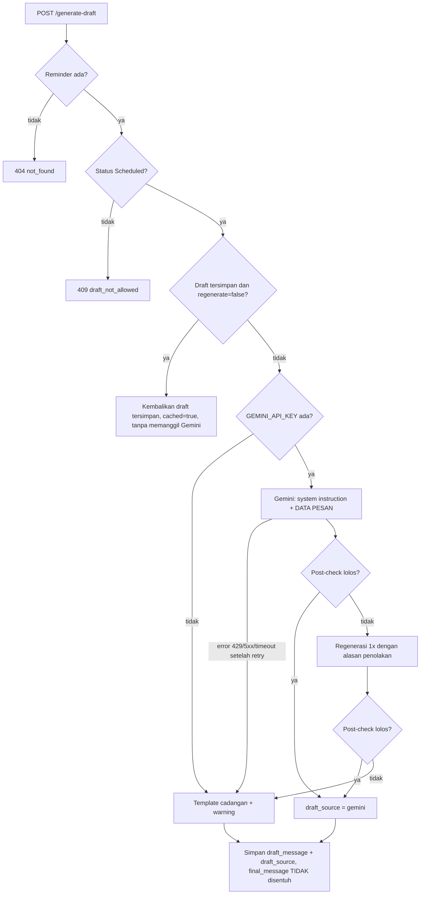

# Prompt Engineering — Draft Pesan WhatsApp (Gemini)

> **PROTOTYPE.** Semua data customer adalah **synthetic**. Draft dibuat oleh Generative AI (Gemini) dan **tidak
> pernah dikirim otomatis**: admin membaca, mengedit, lalu mengirim sendiri lewat WhatsApp.

Spesifikasi yang mengikat: `docs/AI_SPEC.md` bagian B. Kode: `src/api/services/`
(`prompt_builder.py`, `gemini_client.py`, `post_check.py`, `templates.py`, `draft_service.py`, `draft_eval.py`).
Versi prompt saat ini: **v1** (`PROMPT_VERSION` di `prompt_builder.py`).

## 1. Alur `POST /generate-draft`



Respons selalu **HTTP 200** kecuali 404/409, sehingga admin **selalu punya draft**:

```json
{"reminder_id": 12, "draft_message": "Halo Bu Sari, ...", "draft_source": "gemini",
 "cached": false, "message_type": "reminder_kelas", "warning": null}
```

## 2. Input ke prompt builder (AI_SPEC B1)

| Field spesifikasi | Sumber data | Masuk prompt? |
|---|---|---|
| `nama_customer` | `customers.nama` → diturunkan menjadi sapaan (bagian 4) | Hanya sapaan (nama depan + gelar) |
| `persona` | `customers.persona` | Ya |
| `priority` | `reminders.priority` (kosong → gaya `Low` + warning) | Tidak mentah; diterjemahkan menjadi **arahan isi** |
| `top_factors` | prediksi terakhir di tabel `predictions` | **Tidak.** Hanya dipakai post-check untuk menolak kebocoran |
| `nama_kelas`, `tanggal_jam`, `pelatih` | `schedules` (boleh kosong) | Ya; jika kosong prompt melarang menyebut jadwal |
| `tipe_pesan` | `reminders.message_type` | Ya, beserta arahannya |
| `tanggal_pesan_terakhir` | `sent_at` terbaru dari reminder lain milik customer | Ya (atau "tidak ada data") |

Nomor WhatsApp dan catatan customer **tidak pernah** dikirim ke Gemini.

**Arahan isi per prioritas** (label `Low/Medium/High` tidak ditulis ke prompt agar tidak bocor):

| Prioritas | Arahan isi di prompt |
|---|---|
| Low | Pengingat ringan: sampaikan detail kelas dengan ramah dan singkat. Tidak perlu menanyakan kendala. |
| Medium | Pengingat yang hangat: sampaikan detail kelas, lalu tanyakan kabar atau kendala dengan ramah dalam satu kalimat. |
| High | Lebih personal dan proaktif: tanyakan kabar dengan tulus, tawarkan bantuan atau opsi ganti jadwal (tanpa menyebut jadwal pengganti tertentu), tetap tanpa menekan atau menyalahkan. |

**Arahan per jenis pesan:** `reminder_kelas` = ingatkan kelas; `follow_up_absen` = customer tidak hadir di kelas
yang tercantum, tanyakan kabar tanpa menyalahkan dan tanpa menyebut jumlah ketidakhadiran, tawarkan bantuan jadwal
pengganti; `follow_up_tidak_merespons` = ingatkan kembali dengan sopan, minta konfirmasi bila berkenan, tanpa
menyindir. Prompt juga menyebut apakah kelas **akan datang/sudah berlalu** dan label **hari ini/besok/kemarin**
yang dihitung di backend, agar model tidak menebak tanggal relatif.

## 3. Template prompt (v1)

Gemini menerima dua bagian: **system instruction** (aturan + 6 contoh few-shot) dan **prompt per permintaan**
(blok `DATA PESAN`). Parameter: `temperature` dari `GEMINI_TEMPERATURE` (default 0,7).

### 3.1 Aturan (bagian awal system instruction, disalin persis dari kode)

```text
Kamu adalah admin Gymnasium, tempat gym dan private coaching, yang menulis pesan WhatsApp untuk member.
Tugasmu: tulis SATU pesan WhatsApp berdasarkan DATA PESAN. Admin akan membaca dan mengedit pesanmu sebelum mengirimnya sendiri.

ATURAN UMUM
1. Bahasa Indonesia yang baik dan natural, siap dikirim lewat WhatsApp.
2. Panjang 60-80 kata. Teks biasa tanpa markdown: tanpa tanda bintang, tanpa judul, tanpa daftar berpoin, tanpa tanda kurung siku atau kurawal.
3. Buka dengan "Halo" diikuti sapaan pembuka persis seperti di DATA PESAN. Jangan memakai salam waktu (selamat pagi/siang/sore/malam) karena jam kirim belum pasti.
4. Sebut nama kelas, tanggal, jam, dan pelatih persis seperti di DATA PESAN. Kata "hari ini", "besok", atau "kemarin" hanya boleh dipakai jika tercantum di DATA PESAN.
5. Akhiri dengan salam penutup "Salam hangat, Admin Gymnasium" (ibu-ibu), "Salam hormat, Admin Gymnasium" (lansia), atau "Salam, Admin Gymnasium" (menengah_atas).
6. Tulis hanya isi pesan, tanpa pengantar, judul, atau penjelasan.

GAYA PER PERSONA
- ibu-ibu: hangat dan akrab, sapaan "Bu"/"Ibu", emoji maksimal 2.
- lansia: sangat sopan, kalimat pendek dan jelas, tanpa singkatan dan tanpa istilah asing, sebaiknya tanpa emoji (maksimal 1), tidak terkesan terburu-buru.
- menengah_atas: profesional, ringkas, sopan, emoji maksimal 1.

LARANGAN KERAS
1. Jangan menyebut prioritas, kategori, risiko, skor, model, AI, analisis, prediksi, persentase, atau data internal apa pun.
2. Jangan menyebut jumlah absen atau ketidakhadiran, dan jangan bernada menyalahkan atau menghakimi.
3. Jangan mengarang fakta: jangan menyebut harga, promo, diskon, hadiah, jadwal, tanggal, jam, atau nama yang tidak ada di DATA PESAN. Jika suatu data tidak ada, jangan disebut.
4. Jangan memberi klaim kesehatan atau medis (misalnya menyembuhkan penyakit atau menurunkan tekanan darah).
5. Jangan memakai nada rasa bersalah atau urgensi palsu (misalnya "kesempatan terakhir", "jangan sampai rugi").
6. Jangan menyebut kata "lansia", "persona", atau label kelompok customer lainnya.
```

### 3.2 Contoh few-shot (2 per persona)

Data contoh fiktif (nama, kelas, dan pelatih yang tidak ada di data synthetic) agar model tidak menyalinnya;
post-check menolak draft yang memuat istilah khusus contoh.

| # | Persona | Prioritas | Jenis pesan | Sapaan |
|---|---|---|---|---|
| 1 | ibu-ibu | Low | reminder_kelas | Bu Rina |
| 2 | ibu-ibu | High | follow_up_absen | Bu Wulan |
| 3 | lansia | Medium | reminder_kelas | Bapak/Ibu Harsono |
| 4 | lansia | High | follow_up_tidak_merespons | Ibu Endang |
| 5 | menengah_atas | Low | reminder_kelas | Ibu Vania |
| 6 | menengah_atas | Medium | follow_up_absen | Bapak/Ibu Santoso |

Contoh lengkap (Contoh 1) persis seperti di system instruction:

```text
DATA PESAN
- Sapaan pembuka: Bu Rina
- Kata ganti customer: Ibu
- Persona: ibu-ibu (hangat dan akrab)
- Jenis pesan: reminder kelas. Ingatkan kelas yang tercantum.
- Arahan isi: Pengingat ringan: sampaikan detail kelas dengan ramah dan singkat. Tidak perlu menanyakan kendala.
- Kelas: Stretching Pagi (kelas grup)
- Waktu kelas: Rabu, 4 Maret 2026 pukul 07.30 WIB (besok; akan datang)
- Pelatih: Coach Wina
- Pesan terakhir dari kami: tidak ada data (jangan disebut)
PESAN:
Halo Bu Rina, semoga sehat dan semangat selalu ya 😊 Kami mau mengingatkan jadwal kelas Stretching Pagi besok, Rabu, 4 Maret 2026 pukul 07.30 WIB bersama Coach Wina. Kalau ada perubahan rencana atau kendala, kabari kami saja lewat pesan ini ya, Bu. Kami tunggu kehadirannya, semoga latihannya menyenangkan dan seru bersama teman-teman lainnya. Sampai ketemu di kelas! Salam hangat, Admin Gymnasium
```

### 3.3 Prompt per permintaan

```text
DATA PESAN
- Sapaan pembuka: Bu Sari
- Kata ganti customer: Ibu
- Persona: ibu-ibu (hangat dan akrab)
- Jenis pesan: reminder kelas. Ingatkan kelas yang tercantum.
- Arahan isi: Pengingat ringan: sampaikan detail kelas dengan ramah dan singkat. Tidak perlu menanyakan kendala.
- Kelas: Zumba Fun (kelas grup)
- Waktu kelas: Selasa, 10 November 2026 pukul 09.00 WIB (besok; akan datang)
- Pelatih: Coach Dina
- Pesan terakhir dari kami: tidak ada data (jangan disebut)

Tulis PESAN untuk DATA PESAN di atas.
```

Jika post-check gagal, prompt regenerasi menambahkan:
`CATATAN: pesan sebelumnya ditolak pemeriksaan otomatis karena: <alasan>. Tulis ulang pesan yang memenuhi SEMUA aturan.`

## 4. Aturan sapaan

Jenis kelamin **tidak ditebak dari nama depan** (data synthetic memakai nama acak dan tebakan bisa salah).

| Kondisi | ibu-ibu | lansia / menengah_atas | Kata ganti di kalimat |
|---|---|---|---|
| Nama diawali gelar perempuan (`Ibu`, `Bu`, `Ny.`, `Nyonya`, `Hj.`) | `Bu Sari` | `Ibu Sari` | `Ibu` |
| Nama diawali gelar laki-laki (`Bapak`, `Pak`, `Bpk.`, `Tn.`, `Tuan`, `H.`) | `Pak Budi` | `Bapak Budi` | `Bapak` |
| Tanpa gelar (jenis kelamin tidak jelas) | `Bu Sari` (persona ibu-ibu) | `Bapak/Ibu Hendra` | `Ibu` / `Bapak/Ibu` |

Gelar netral (`Dr.`, `Prof.`, `Ir.`, `Drs.`, `Dra.`) dibuang tanpa menyimpulkan apa pun. Panggilan = kata pertama
setelah gelar ("Ibu Sari Wijaya" → "Sari"); nama huruf besar semua dirapikan ("RATNA" → "Ratna").

## 5. Post-check (`post_check.py`)

Fakta yang memang diberikan (nama kelas, pelatih, nama customer) di-*mask* dulu, sehingga kelas seperti
"Aerobic Low Impact" atau "Senam Ringan Lansia" tidak dianggap kebocoran label.

| Pemeriksaan | Contoh yang ditolak |
|---|---|
| Kosong / terlalu pendek (< 15 kata) / terlalu panjang (> 100 kata atau > 700 karakter) | respons kosong, jawaban terpotong |
| Kata terlarang: label internal & AI | prioritas, risiko, AI, model, skor, analisis, prediksi, High/Medium/Low |
| Label kelompok customer | lansia, persona, segmen, kategori |
| Kebocoran `top_factors` / statistik | teks top_factors persis, `%`, "absen berturut-turut", "3 kali absen", "selama 20 hari" |
| Harga/promo karangan | promo, diskon, gratis, harga, Rp 100.000 |
| Klaim kesehatan/medis | menyembuhkan, obat, terapi, tekanan darah, dijamin |
| Rasa bersalah / urgensi palsu | kesempatan terakhir, jangan sampai ketinggalan, rugi, kecewa |
| Jadwal karangan | jam, tanggal, atau nama hari yang tidak ada di data; nama kelas tidak disebut |
| Format | markdown/tanda bintang, placeholder `[Nama]`/`{...}`, pengantar "Berikut draft..." |
| Gaya | emoji melebihi batas persona (ibu-ibu 2, lansia 1, menengah_atas 1), singkatan (yg, dgn, utk) |
| Menyalin contoh few-shot | nama/kelas/pelatih yang hanya ada di contoh |

Post-check bersifat **penyaring konservatif**, bukan jaminan: admin tetap wajib membaca draft sebelum mengirim.

## 6. Desain fallback (`templates.py`)

- 9 template statis (**3 persona × 3 jenis pesan**), tidak bergantung pada prioritas, hanya memakai data yang ada.
  Jika jadwal kosong, info kelas diganti frasa umum ("jadwal kelas berikutnya" / "kelas sebelumnya").
- Semua kombinasi template diuji lolos post-check (dengan/tanpa jadwal, berbagai sapaan).
- Dipakai bila: `GEMINI_API_KEY` kosong; Gemini gagal (429, 5xx, timeout, koneksi, 400/401/403/404) setelah retry;
  respons kosong/terlalu panjang/melanggar aturan setelah **1 kali regenerasi**; error tak terduga.
- Respons memuat `draft_source="template_fallback"` dan `warning` berbahasa Indonesia, misalnya
  "Kuota Gemini habis atau terlalu banyak permintaan (HTTP 429). Coba regenerate beberapa saat lagi. Draft dibuat
  dari template cadangan; periksa dan sesuaikan sebelum dikirim." Draft cadangan juga disimpan; pemanggilan
  berikutnya tanpa `regenerate` mengembalikannya dengan warning "Gunakan regenerate untuk mencoba Gemini lagi."

## 7. Ketahanan pemanggilan Gemini (`gemini_client.py`)

| Aspek | Nilai | Catatan |
|---|---|---|
| SDK | `google-genai` (`client.models.generate_content`) | Diverifikasi dari dokumentasi resmi dan source paket 2.34.0 |
| Model | env `GEMINI_MODEL`; jika kosong default `gemini-3.5-flash-lite` (di `config.py`) | Model stabil Flash-Lite menurut halaman model resmi (dicek 8 Nov 2026) |
| Temperature | env `GEMINI_TEMPERATURE`, default 0,7 | Dokumentasi Google menyebut model Gemini 3.6+ mengabaikan temperature kustom |
| Timeout | env `GEMINI_TIMEOUT_SECONDS`, default 20 detik | `HttpOptions(timeout=...)` dalam milidetik |
| Retry | env `GEMINI_MAX_RETRIES`, default 2 (total 3 percobaan) | Hanya 408/429/5xx/timeout/koneksi; backoff 1 s, 2 s (+jitter ≤10%, maks 8 s). Retry bawaan SDK tidak aktif |
| `max_output_tokens` | tidak diisi | Batas ini ikut menghitung token "thinking" sehingga batas rendah bisa memotong jawaban; panjang dijaga post-check |
| Klien | disuntik lewat `create_app(draft_generator=...)` / `deps.get_draft_generator` | Tes memakai klien palsu dan pemblokir socket |

Waktu tunggu terburuk: 3 percobaan × timeout + backoff, dikali 2 bila terjadi regenerasi. Untuk UI, tampilkan
spinner.

## 8. Privasi & free tier

- Free tier Gemini boleh memakai input untuk perbaikan produk Google → **hanya kirim data synthetic**. Jangan
  memasukkan data customer sungguhan selama memakai free tier.
- Yang dikirim: sapaan (nama depan), persona, arahan isi, jenis pesan, info kelas, tanggal pesan terakhir. Tidak
  dikirim: nomor WhatsApp, catatan customer, `top_factors`, label prioritas mentah, probabilitas.
- Kuota harian free tier kecil; 429 ditangani dengan retry terbatas lalu template cadangan.

## 9. Evaluasi kualitas (9 skenario)

Skrip `src/api/services/draft_eval.py` menjalankan **3 persona × 3 prioritas** memakai pipeline yang sama dengan
endpoint (prompt → Gemini → post-check → fallback), lalu menulis tabel Markdown ke
`docs/draft_eval/draft_eval_<versi>_<tanggal-jam>.md`. Agar 9 skenario juga mencakup ketiga jenis pesan:
Low → `reminder_kelas`, Medium → `follow_up_tidak_merespons`, High → `follow_up_absen`
(opsi `--message-type` memaksa satu jenis).

```powershell
.\.venv\Scripts\Activate.ps1
python -m src.api.services.draft_eval --dry-run   # cek format tanpa Gemini
python -m src.api.services.draft_eval             # memanggil Gemini (butuh GEMINI_API_KEY di .env)
```

Rubrik (diisi **manual**, 1 = buruk, 5 = sangat baik):

| Kolom | Pertanyaan |
|---|---|
| Kesesuaian nada | Apakah gaya cocok dengan persona dan intensitas prioritas, tanpa menekan/menyalahkan? |
| Kejelasan info kelas | Apakah nama kelas, tanggal, jam, dan pelatih jelas dan benar? |
| Tidak ada kebocoran label | Bebas dari prioritas/risiko/AI/skor/top_factors/label persona? |
| Tidak ada fakta karangan | Bebas dari harga, promo, jadwal, klaim kesehatan yang tidak ada di data? |
| Kesiapan kirim | Bisa langsung dikirim tanpa edit (5) sampai perlu ditulis ulang (1)? |

### Hasil evaluasi v1

> **BELUM DIISI.** Jalankan skrip dengan API key asli, tempel/tautkan tabel hasilnya di sini, lalu isi rubrik.
> Jangan mengisi angka sebelum skrip benar-benar dijalankan.

- File hasil: `docs/draft_eval/...` (isi setelah dijalankan)
- Model dan tanggal jalan: ...
- Jumlah draft `gemini` vs `template_fallback`: ...
- Rata-rata rubrik per kolom: ...

## 10. Iterasi prompt (v1 → v2)

> Diisi pemilik setelah menjalankan evaluasi v1. Ubah `_RULES`/`FEW_SHOT_EXAMPLES`, naikkan `PROMPT_VERSION`
> menjadi `"v2"`, jalankan ulang skrip, lalu bandingkan. Bagian 3.1 dokumen ini harus diperbarui bersama kode
> (tes `test_prompt_doc_matches_code` akan gagal bila tidak sinkron).

| Iterasi | Masalah yang ditemukan (bukti: skenario no.) | Perubahan prompt | Dampak (rubrik/fallback sebelum → sesudah) |
|---|---|---|---|
| v1 | (isi setelah evaluasi v1) | Versi awal: aturan + 6 few-shot + post-check | (isi) |
| v2 | (isi) | (isi) | (isi) |

## 11. Keterbatasan

- Kualitas draft belum dievaluasi dengan Gemini sungguhan (menunggu bagian 9 diisi).
- Post-check berbasis pola kata; bisa meloloskan pelanggaran halus (mis. nada menyalahkan tanpa kata terlarang)
  atau menolak kalimat wajar (mis. menyebut hari lain). Admin tetap penanggung jawab akhir isi pesan.
- Data synthetic; nada pesan belum diuji pada customer sungguhan.
